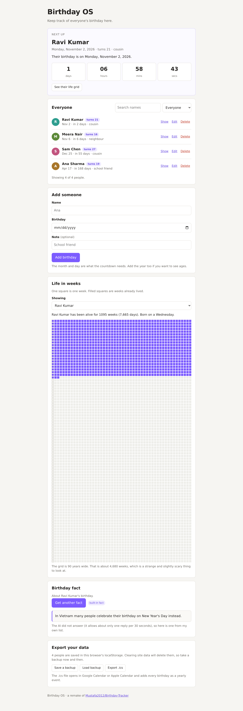
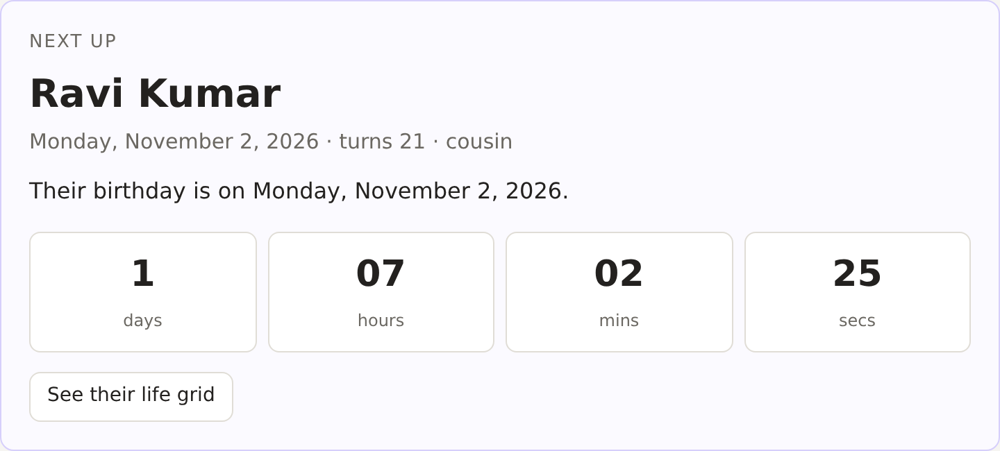
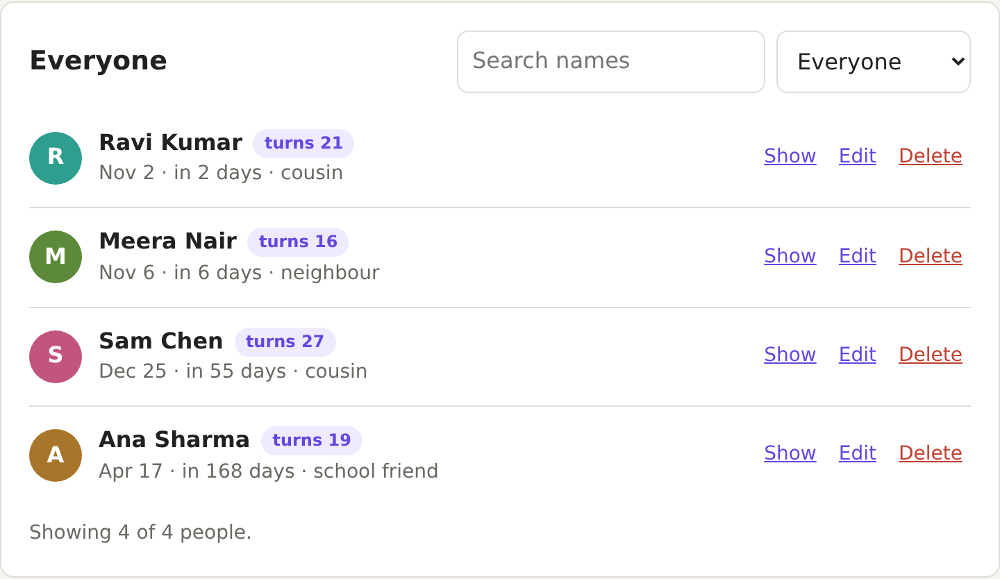
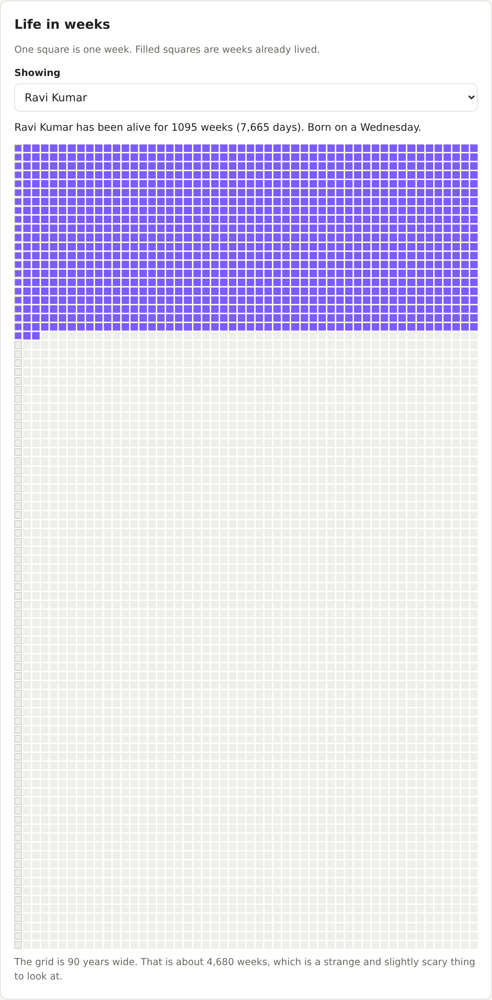
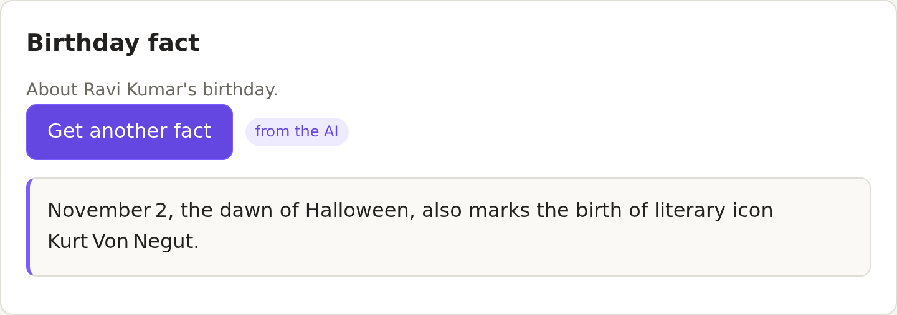
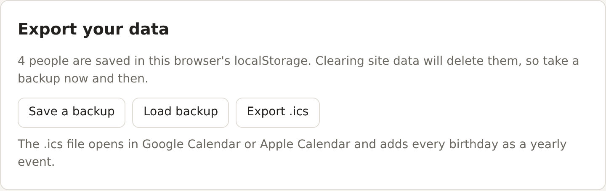
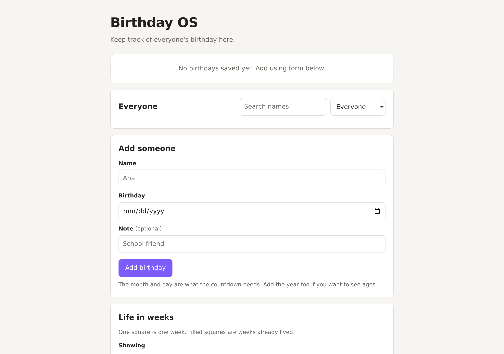
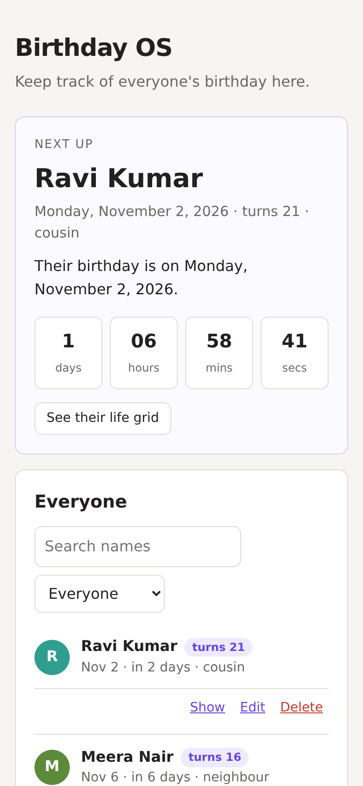

# Birthday OS

A birthday tracker that runs in your browser. Add the people you know and it
keeps a live countdown to whoever's birthday is next.

**Live:** <https://birthday-tracker-remake.vercel.app/>

Built with plain HTML, CSS and JavaScript. It is a remake of
[Mustafa2012/Birthday-Tracker](https://github.com/Mustafa2012/Birthday-Tracker).



---

## What it does

- **Countdown** to the next birthday, down to the second
- **A list of everyone**, sorted by who is closest
- **Search and filters** for the next 7 days or this month
- **Ages**, if you add the birth year
- **Life in weeks** grid for any person
- **AI birthday facts** about the selected date
- **Saved in your browser**, so a reload keeps everything
- **Backup and calendar export** as `.json` or `.ics`

---

## Screenshots

### The countdown

Whoever is next gets a big card with the days, hours, minutes and seconds left.



### Everyone

The list is sorted by who is closest. Search by name, or filter to the next week
or this month.



### Life in weeks

Every square is one week. Filled squares are weeks already lived, out of 90
years. It is a slightly scary thing to look at.



### AI birthday fact

Press the button and an AI writes a short fact about that date.



### Your data

Save a backup as JSON, load one back, or export an `.ics` file that puts every
birthday into Google Calendar or Apple Calendar.



### First run



### On a phone



---

## Run it

Open `index.html` in a browser. That is it.

```
index.html    style.css    dates.js    ai.js    app.js
```

| File | What's in it |
|---|---|
| `index.html` | The page |
| `style.css` | The styling |
| `dates.js` | All the date maths |
| `ai.js` | The AI request and cleaning up the reply |
| `app.js` | Everything else: the list, the form, saving, confetti |

---

## Where the facts come from

The AI facts use [Pollinations](https://pollinations.ai), which is free and needs
no API key.

The free AI tier only allows about one reply every 30 seconds. When it says no,
the app reuses the last fact it got, or shows one from a built-in list, and tells
you which. It never just breaks.

---

## Keeping the dates right

Three things in `dates.js` are on purpose:

1. **Dates are never read with `new Date("2008-04-17")`.** JavaScript treats that
   as UTC midnight, which is the previous day for anyone east of UTC, like India.
   The string is split and the date is built by hand instead, so it stays local.
2. **Dates are compared at noon**, twelve hours from either midnight, so daylight
   saving changes cannot move a day.
3. **29 February birthdays are celebrated on the 28th** in normal years.

---